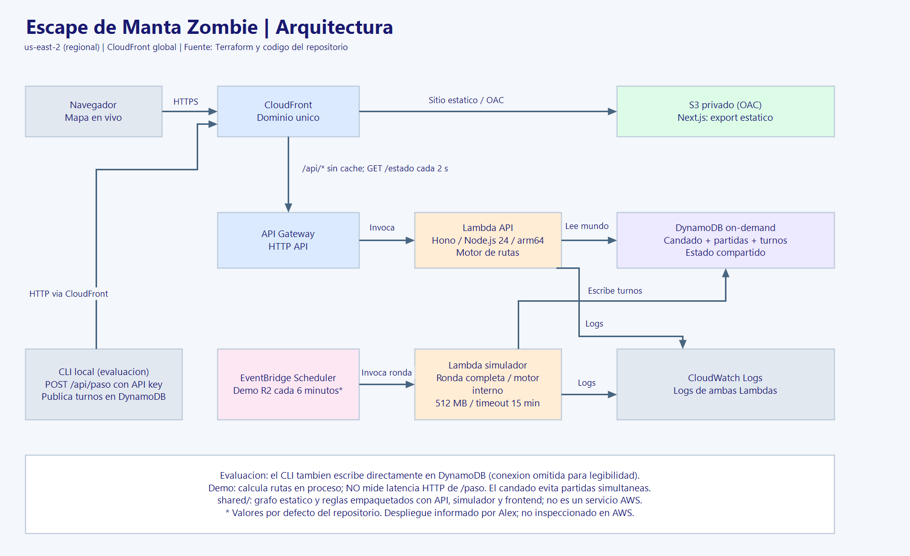
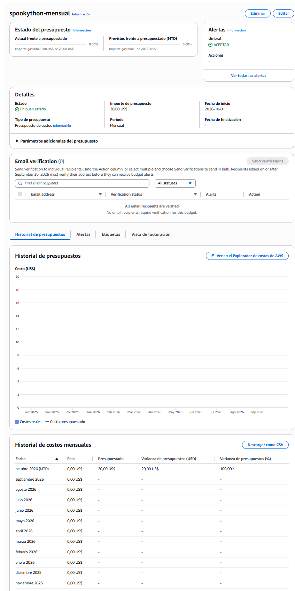

# Escape de Manta Zombie 🧟

**SpookyThon 2026 · Track A** · Equipo **abcstack** (Anthony, Kevin, Alex)

Motor de rutas en tiempo real sobre AWS. Cada 2 segundos los zombies se mueven por el mapa de Manta y nuestro servicio le dice a cada sobreviviente cuál es su siguiente paso para llegar a un refugio sin ser mordido. Es el mismo problema que resuelven las apps de delivery o las rutas de evacuación: **el mapa cambia mientras te mueves**.

> **Estado:** en desarrollo. Las secciones marcadas `TODO` las completa su dueño en el PR de la tarea correspondiente (ver `AGENTS.md` §9).

| Enlace | URL |
|---|---|
| Mapa en vivo | `TODO (Alex): site_url de terraform output` |
| `POST /paso` | `TODO (Alex): <site_url>/api/paso` |
| `GET /estado` | `TODO (Alex): <site_url>/api/estado` |

---

## Qué hace

<!-- TODO (Anthony): 1 párrafo + captura o GIF del mapa en vivo (docs/mapa.png). -->

- **Grafo de Manta:** ~300 intersecciones y sus calles (avenida, calle, callejón, puente), extraídas de OpenStreetMap, con 4 refugios.
- **Simulador del apocalipsis:** turnos de 2 s; caminantes, corredores, hordas y dormidos; puentes que colapsan y calles que se bloquean.
- **`POST /paso`:** recalcula la ruta de cada sobreviviente en cada turno con los zombies de ese turno.
- **Mapa en vivo:** zombies (un ícono por tipo), sobrevivientes, refugios, calles bloqueadas y zonas de horda, actualizado cada turno; al seleccionar un sobreviviente se ve su ruta planificada.

## Cómo se usa el mapa

<!-- TODO (Anthony): qué ve el usuario, leyenda de íconos, panel de métricas (vivos, a salvo, mordidos, p95). Debe entenderse sin explicación. -->

## Arquitectura



<!-- TODO (Alex): exportar docs/arquitectura.png desde docs/arquitectura.drawio y explicarlo en 3-5 líneas. -->

```text
Navegador ──▶ CloudFront ──┬─▶ S3 (mapa estático, privado vía OAC)
                           └─▶ /api/* ─▶ API Gateway HTTP API ─▶ Lambda (Node 24, arm64, Hono) ─▶ DynamoDB
Simulador ──▶ escribe el turno en DynamoDB ──▶ POST /api/paso por cada sobreviviente
```

| Pieza | Servicio |
|---|---|
| Sitio y dominio único | CloudFront + S3 |
| API | API Gateway HTTP API (throttling 300 rps / 600 burst) |
| Cómputo | Lambda `nodejs24.x` arm64, 1024 MB |
| Estado del mundo | DynamoDB on-demand, single-table |
| Monitoreo | CloudWatch |
| Infraestructura como código | Terraform (`infra/`) |

Detalle: `INFRA.md`.

## Decisiones de diseño

### Motor de rutas

<!-- TODO (Kevin): A* (heurística, cola de prioridad), costo base "1 turno + ε × tiempo por tipo de calle", por qué se optimiza en turnos y no en metros. -->

### Costos de peligro

<!-- TODO (Kevin): tabla final de AGENTS.md §4.4 con los valores reales: zombie visible, horda + vecinos, cruce en sentido contrario, predicción de corredores, dormidos (no se usan: el motor no hace trampa). -->

### Elección y capacidad de refugios

<!-- TODO (Kevin): cómo se elige el refugio y, si se llega al nivel Pro, el contador atómico de capacidad. -->

### Estado compartido y latencia

<!-- TODO (Kevin/Alex): por qué el estado vive en DynamoDB y no en la memoria de la Lambda, caché por número de turno, presupuesto interno de 300 ms con paso seguro de respaldo, por qué no ElastiCache. -->

### Seguridad

- `POST /paso` exige la cabecera `x-api-key`, comparada en tiempo constante. La key llega a la Lambda por una variable de Terraform (`TF_VAR_api_key`), nunca está en el código.
- El rol de la Lambda tiene solo las acciones de DynamoDB que usa (sin `Scan`) y escribe logs únicamente en su log group.
- El bucket del sitio es privado: solo CloudFront lo lee.
- Ningún secreto, Account ID ni state de Terraform está en el repositorio (`CONTRIBUTING.md`).

## Cómo desplegar

<!-- TODO (Alex): confirmar y ajustar tras el primer deploy real. -->

Requisitos: Node 24, Terraform `~> 1.9`, AWS CLI v2 con el perfil `spookython`.

```bash
npm ci
npm run build -w backend
cd infra
cp backend.hcl.example backend.hcl        # completar con el bucket del state
export TF_VAR_api_key="<api key>"
terraform init -backend-config=backend.hcl
terraform plan -out=tfplan
terraform apply tfplan
```

Frontend y verificación: `INFRA.md` §3. Primera vez en una cuenta nueva: `infra/README.md` §1.

## Cómo probar

### `POST /paso`

```bash
curl -X POST "<site_url>/api/paso" \
  -H "content-type: application/json" \
  -H "x-api-key: <api key>" \
  -d '{"sobrevivienteId":"S-0089","nodoActual":"N-0117","turno":142}'
# → {"siguienteNodo":"N-0118"}
```

<!-- TODO (Kevin): confirmar el ejemplo con nodos reales del grafo. -->

### Tests

```bash
npm test
npm run typecheck
```

### Simulador

Desde la raíz, ejecutar una ronda local reproducible (150 turnos de 2 segundos):

```powershell
node --import tsx tools/simulador/correr.ts --ronda=1 --semilla=42
```

Cambiar `--ronda` a `2` o `3` para los escenarios de 80 y 200 sobrevivientes.
El modo local usa un motor falso: no demuestra la supervivencia ni la latencia
del backend real. Para HTTP, publicación en DynamoDB, variables requeridas y
precauciones del candado, consultar [la guía del simulador](tools/simulador/README.md).
La ejecución contra AWS requiere autorización del equipo y el Scheduler de demo
deshabilitado. No se despliegan recursos ni se reemplazan partidas activas.

Pruebas del simulador (no incluidas en los workspaces de `npm test`):

```powershell
node --import tsx --test tools/simulador/*.test.ts
node node_modules/typescript/bin/tsc -p tools/simulador/tsconfig.json
```

### Cómo se mide la latencia

En modo HTTP, el simulador registra una duración por pedido a `/paso`, incluyendo
la lectura y validación del cuerpo, errores y timeouts. Informa p50/p95/p99 por
rango más cercano, cantidad de llamadas y porcentaje de errores. Los pedidos
superiores a 500 ms se abortan y el sobreviviente se queda quieto. En modo local,
la latencia HTTP figura como no medida. También informa vivos, rescatados,
mordidos y turnos reales de llegada frente al mínimo en el mapa sin peligros.
Los resultados reales de AWS y su contraste con CloudWatch siguen pendientes;
no se sustituyen por resultados del motor falso.

## Resultados de nuestra prueba de fuego

<!-- TODO (todos, martes noche): tabla con las 3 corridas. -->

| Ronda | Sobrevivientes | Supervivencia | Eficiencia | p95 `/paso` | Errores |
|---|---|---|---|---|---|
| R1 Anochecer | 20 | | | | |
| R2 Medianoche | 80 | | | | |
| R3 Apocalipsis | 200 | | | | |

## Costos

AWS Budget con alerta desde el primer día (alertas por SNS al 50 %, 80 % y 100 % previsto; detalle en `INFRA.md` §5):



Costo mensual estimado y gasto real del evento: `docs/costos.md`.

## Limitaciones

<!-- TODO (todos): cada uno agrega las de su parte. -->

- El motor no conoce la posición de los dormidos hasta que despiertan: no usa información invisible.

## Estructura del repositorio

```text
shared/     grafo, reglas del juego y schemas compartidos por el motor y el simulador
backend/    Lambda con Hono: /api/paso, /api/estado, /api/health
frontend/   mapa en vivo (Next.js + MapLibre GL)
tools/      extracción del grafo desde OSM y simulador
infra/      Terraform
docs/       arquitectura, costos y captura del Budget
```

## Equipo

| Integrante | Rol |
|---|---|
| Anthony | Frontend (mapa en vivo, panel), coordinación |
| Kevin | Motor de rutas (`/paso`), reglas de peligro, refugios |
| Alex | Grafo de Manta, simulador, infraestructura y latencia |

Cómo trabajamos: `CONTRIBUTING.md`. Hoja de ruta paso a paso: `docs/HOJA_DE_RUTA.md`.
