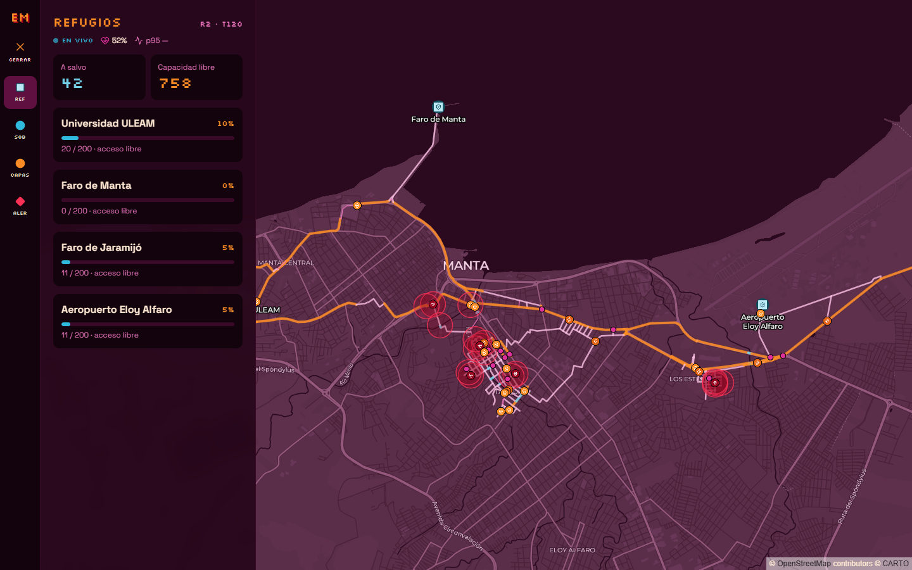

# Escape de Manta Zombie

**SpookyThon 2026 · Track A** · Equipo **abcstack** (Anthony, Kevin, Alex)

Motor de rutas en tiempo real sobre AWS. Cada 2 segundos los zombies se mueven por el mapa de Manta y nuestro servicio le dice a cada sobreviviente cuál es su siguiente paso para llegar a un refugio sin ser mordido. Es el mismo problema que resuelven las apps de delivery o las rutas de evacuación: **el mapa cambia mientras te mueves**.

> **Estado (27 de octubre de 2026):** desplegado en AWS (`us-east-2`) y verificado: el mapa público muestra rondas demo en vivo y `POST /paso` exige API key. Pendiente: las corridas completas de la prueba de fuego contra AWS (ver [Limitaciones](#limitaciones)).

| Enlace | URL |
|---|---|
| Mapa en vivo | https://d2pm91xddlib8g.cloudfront.net/mapa |
| `POST /paso` | `https://d2pm91xddlib8g.cloudfront.net/api/paso` (cabecera `x-api-key`) |
| `GET /estado` | https://d2pm91xddlib8g.cloudfront.net/api/estado |
| `GET /sobrevivientes/:id/ruta` | `https://d2pm91xddlib8g.cloudfront.net/api/sobrevivientes/S-0001/ruta` |

---

## Qué hace

Un simulador mueve zombies por un grafo real de Manta en turnos de 2 segundos y, por cada sobreviviente, le pregunta a nuestro `POST /paso` cuál es su siguiente nodo. El motor recalcula la ruta en cada pedido con los zombies de ese turno, evita las zonas peligrosas y responde en milisegundos. El mapa en vivo muestra todo lo que pasa, turno a turno, desde la misma URL pública.



- **Grafo de Manta:** ~300 intersecciones y sus calles (avenida, calle, callejón, puente), extraídas de OpenStreetMap, con 4 refugios.
- **Simulador del apocalipsis:** turnos de 2 s; caminantes, corredores, hordas y dormidos; puentes que colapsan y calles que se bloquean.
- **`POST /paso`:** recalcula la ruta de cada sobreviviente en cada turno con los zombies de ese turno.
- **Mapa en vivo:** zombies (un ícono por tipo), sobrevivientes, refugios, calles bloqueadas y zonas de horda, actualizado cada turno; al seleccionar un sobreviviente se ve su ruta planificada.

## Cómo se usa el mapa

Abrí el mapa en vivo: no hace falta iniciar sesión ni configurar nada. Cada 2 segundos llega un turno nuevo. La leyenda, abajo a la derecha del mapa, explica cada ícono y color, y el botón **Ayuda** del menú resume qué se está viendo y qué se puede hacer.

| En el mapa | Significado |
|---|---|
| Círculo celeste | Sobreviviente en ruta; la flecha corta apunta a su siguiente nodo |
| Círculo magenta | Sobreviviente mordido |
| Calavera, rayo y riesgo biológico | Caminante, corredor y horda; el halo rojo marca la zona que bloquea la horda |
| Cuadrado con escudo | Refugio, con su nombre |
| Línea celeste punteada | Ruta planificada del sobreviviente seguido |
| Calle roja | Calle bloqueada o puente colapsado |
| Naranja, rosa y celeste | Avenida, calle y puente |

El menú lateral (barra inferior en el celular) abre cuatro secciones, con íconos en los mismos colores del mapa:

- **Refugios:** a salvo en cada refugio y capacidad libre.
- **Personas:** búsqueda por número o refugio y filtros por estado; al elegir un sobreviviente, el mapa lo sigue y dibuja su ruta.
- **Capas:** prende o apaga cada capa del mapa.
- **Alertas:** hordas nuevas, calles bloqueadas, refugios llenos y mordidas, con un aviso flotante.

Arriba del panel, siempre visibles: ronda y turno, **EN VIVO** con la edad real del último turno (solo con datos reales), porcentaje de sobrevivientes con vida y **tiempo de respuesta del motor** (p95 de `/paso`, con el color del tramo de puntaje: 150, 300 y 500 ms). Los sobrevivientes se nombran por número ("Sobreviviente 5") y su ubicación por barrio o refugio cercano, nunca por códigos internos. Si no hay partida o la API no responde, el mapa sigue con una simulación local y lo dice: **Esperando la próxima ronda** o **Sin conexión**. Si un turno no llega, se mantiene el último turno real unos segundos y se muestra **Reconectando**. El botón **Ocultar** esconde el panel y deja el mapa completo. En el celular el panel se abre desde la barra inferior.

## Arquitectura


CloudFront sirve el frontend desde S3 privado mediante OAC y envía `/api/*`, sin caché, a API Gateway y la Lambda del API.
El estado compartido vive en DynamoDB; el mapa consulta `/api/estado` cada 2 segundos y recibe el último turno completo.
EventBridge Scheduler inicia las rondas demo en la Lambda del simulador, que calcula movimientos en proceso y publica los turnos.
La evaluación HTTP se ejecuta desde el CLI: publica el mundo y consulta `/api/paso` con API key; la demo no mide esa latencia.
El diagrama representa el código del repositorio, no una inspección de la cuenta AWS.

[Fuente editable en diagrams.net](docs/arquitectura.drawio) · [Flujos y archivos de referencia](docs/arquitectura.md).

| Pieza | Servicio |
|---|---|
| Sitio y dominio único | CloudFront + S3 |
| API | API Gateway HTTP API (throttling 300 rps / 600 burst) |
| Cómputo | Lambda `nodejs24.x` arm64, 1024 MB |
| Estado del mundo | DynamoDB on-demand, single-table |
| Demo automática | Lambda del simulador + EventBridge Scheduler |
| Monitoreo | CloudWatch |
| Infraestructura como código | Terraform (`infra/`) |

Detalle: `INFRA.md`.

## Decisiones de diseño

### Motor de rutas

A* con cola de prioridad (min-heap) y vecinos precalculados al cargar el grafo (`backend/src/motor/astar.ts`). Se recalcula **en cada pedido** con los zombies del turno: ninguna ruta se guarda entre turnos.

- **Costo base de una calle:** `1 turno + ε × (distancia_m / velocidad del tipo)`, con `ε = 0,0001` y velocidades en m/s de avenida 1,6, calle 1,4, puente 1,2 y callejón 1,0.
- **Por qué en turnos y no en metros:** un sobreviviente avanza una calle por turno y la eficiencia se puntúa en turnos. Optimizar solo distancia ÷ velocidad elegiría rutas con más saltos; el término de tiempo solo desempata entre rutas con los mismos turnos.
- **Heurística:** distancia en línea recta al refugio más cercano dividida por la velocidad máxima, escalada por ε. Nunca sobreestima, así que el A* encuentra la ruta de menor costo.

### Costos de peligro

Valores reales de `backend/src/motor/peligros.ts`:

| Situación | Costo |
|---|---|
| Nodo con un zombie visible | Prohibido |
| Horda: su nodo **y todos sus vecinos** | Prohibido |
| Calle bloqueada (evento de ciudad) | No existe |
| Calle por la que un caminante o corredor podría venir de frente (mordida por cruce) | Prohibida |
| Nodo que un corredor alcanza en su próximo turno (hasta 2 calles libres) | +0,9 por corredor (predicción, nivel Pro) |
| Nodo vecino de un caminante | +0,5 |
| Cerca de donde podría haber dormidos | Sin costo: el motor no usa información invisible |

Las penalizaciones son menores que un turno a propósito: desvían la ruta cuando existe una alternativa casi igual de corta, pero nunca hacen que el motor prefiera quedarse quieto. Prohibir el alcance de los corredores, en vez de penalizarlo, dejó más sobrevivientes sin ruta y bajó la supervivencia en nuestras pruebas.

**Si no hay ningún refugio alcanzable**, el sobreviviente no se queda esperando: se mueve al vecino legal más lejano de los zombies que se mueven, o se queda si su nodo ya es el más seguro (`backend/src/motor/evasion.ts`). En nuestras rondas locales con el motor real (16 semillas por ronda), esto junto con la predicción subió los vivos de 25,2 % a 34,1 % en R2 y de 13,8 % a 17,3 % en R3; R1 quedó igual (95 %).

### Elección y capacidad de refugios

El A* busca a la vez hacia los cuatro refugios y se queda con el de menor costo total, descartando los que están dentro de una zona prohibida. La capacidad de cada refugio es provisional (200, a confirmar con la organización) y el límite de capacidad del nivel Pro **no está implementado**: el mapa muestra la ocupación, pero el motor todavía no evita refugios llenos.

### Estado compartido y latencia

- **El estado que cambia vive en DynamoDB, no en la memoria de la Lambda.** Cada instancia puede atender cualquier pedido, y lo que guarda en memoria (el grafo estático) no cambia durante la partida.
- **Una sola partida activa** (`CONTROL / PARTIDA_ACTIVA`, un candado con vencimiento), porque el contrato de `/paso` no trae `partidaId`. El candado se cachea 1 segundo.
- **Caché por `(partidaId, turno)`** con lecturas simultáneas compartidas: los 200 pedidos de un turno cuestan pocas lecturas, y ninguna instancia usa un turno viejo. Si el turno pedido no existe, usa el último existente anterior, nunca un mundo vacío.
- **Presupuesto interno de 300 ms.** Si la lectura o el cálculo no terminan, o fallan, `/paso` responde un paso seguro: quedarse si el nodo es seguro, o el vecino seguro más cercano a un refugio. Nunca responde 500 por eso.
- **`/paso` no escribe:** guardar 200 rutas por turno sumaría latencia. El mapa pide la ruta del sobreviviente seguido a `GET /sobrevivientes/:id/ruta`, que la recalcula con el mismo motor.
- **Sin ElastiCache:** obligaría a meter la Lambda en una VPC (más arranque en frío y un NAT pagado); DynamoDB con caché por turno alcanza.

### Seguridad

- `POST /paso` exige la cabecera `x-api-key`, comparada en tiempo constante. La key llega a la Lambda por una variable de Terraform (`TF_VAR_api_key`), nunca está en el código.
- El rol de la Lambda tiene solo las acciones de DynamoDB que usa (sin `Scan`) y escribe logs únicamente en su log group.
- El bucket del sitio es privado: solo CloudFront lo lee.
- Ningún secreto, Account ID ni state de Terraform está en el repositorio (`CONTRIBUTING.md`).

## Cómo desplegar

Requisitos: Node 24, Terraform `~> 1.9`, AWS CLI v2 con el perfil `spookython`. Probado con el despliegue actual en `us-east-2`.

```bash
npm ci
npm run build -w backend && npm run build:simulador   # Lambda del API y Lambda del simulador
cd infra
cp backend.hcl.example backend.hcl                   # completar con el bucket del state
read -rs TF_VAR_api_key && export TF_VAR_api_key     # pegar la key; no queda en el historial
terraform init -backend-config=backend.hcl           # nunca -reconfigure ni -migrate-state
terraform plan -out=tfplan                           # leerlo: nada para destruir
terraform apply tfplan
```

Frontend (desde la raíz). En Git Bash, `MSYS_NO_PATHCONV=1` es obligatorio: sin él, `/api` se compila como una ruta de Windows y el mapa no llega a la API.

```bash
MSYS_NO_PATHCONV=1 NEXT_PUBLIC_USE_MOCKS=false NEXT_PUBLIC_API_URL=/api npm run build -w frontend
aws s3 sync frontend/out "s3://$(terraform -chdir=infra output -raw bucket_name)" --delete
aws cloudfront create-invalidation --distribution-id "$(terraform -chdir=infra output -raw cloudfront_id)" --paths "/*"
```

Verificación y detalles: `INFRA.md` §3. Primera vez en una cuenta nueva: `infra/README.md` §1. Antes de una ronda de evaluación, apagar las rondas demo (`demo_enabled = false`; ver `tools/simulador/README.md`).

## Cómo probar

### `POST /paso`

```bash
curl -X POST "<site_url>/api/paso" \
  -H "content-type: application/json" \
  -H "x-api-key: <api key>" \
  -d '{"sobrevivienteId":"S-0089","nodoActual":"N-0117","turno":142}'
# → {"siguienteNodo":"N-0072"}
```

`N-0117` y `N-0072` son nodos reales del grafo de Manta: sin zombies en el camino, el motor manda a ese sobreviviente hacia el Faro de Manta. La respuesta real depende de los zombies y bloqueos del turno activo. Sin key o con una incorrecta responde `401`, con un cuerpo inválido `400`, y sin partida activa responde un paso seguro (el mismo nodo).

Ruta completa de un sobreviviente de la partida activa (pública, solo lectura):

```bash
curl "<site_url>/api/sobrevivientes/S-0001/ruta"
# → {"sobrevivienteId":"S-0001","turno":42,"refugio":"R-02","ruta":["N-0117","N-0072","..."]}
```

### Tests

```bash
npm test
npm run typecheck
```

### Simulador

Desde la raíz, ejecutar una ronda local reproducible (150 turnos de 2 segundos):

```powershell
node --import tsx tools/simulador/correr.ts --ronda=1 --semilla=42
```

Cambiar `--ronda` a `2` o `3` para los escenarios de 80 y 200 sobrevivientes.
El modo local usa un motor falso: no demuestra la supervivencia ni la latencia
del backend real. Para HTTP, publicación en DynamoDB, variables requeridas y
precauciones del candado, consultar [la guía del simulador](tools/simulador/README.md).
La ejecución contra AWS requiere autorización del equipo y el Scheduler de demo
deshabilitado. No se despliegan recursos ni se reemplazan partidas activas.

Pruebas del simulador (no incluidas en los workspaces de `npm test`):

```powershell
node --import tsx --test tools/simulador/*.test.ts
node node_modules/typescript/bin/tsc -p tools/simulador/tsconfig.json
```

### Cómo se mide la latencia

En modo HTTP, el simulador registra una duración por pedido a `/paso`, incluyendo
la lectura y validación del cuerpo, errores y timeouts. Informa p50/p95/p99 por
rango más cercano, cantidad de llamadas y porcentaje de errores. Los pedidos
superiores a 500 ms se abortan y el sobreviviente se queda quieto. En modo local,
la latencia HTTP figura como no medida. También informa vivos, rescatados,
mordidos y turnos reales de llegada frente al mínimo en el mapa sin peligros.

Durante una ronda HTTP, cada turno guarda además el p95 de la ronda hasta ese momento, y el panel del mapa lo muestra en vivo (`metricas.p95ms` de `/estado`). Antes de cada ronda contra AWS, `tools/simulador/calentar.ts` dispara ráfagas de pedidos simultáneos para dejar calientes las instancias de Lambda.

El contraste con CloudWatch de la primera R1 contra AWS (27 de octubre) está en [Resultados](#resultados-de-nuestra-prueba-de-fuego).

## Resultados de nuestra prueba de fuego

**Primera R1 contra AWS (27 de octubre, 09:33 a 09:39, hora de Ecuador):** 369 pedidos a `/paso`, 32 respondieron HTTP 503 y 10 se cortaron a los 500 ms. CloudWatch explica ambos: la cuenta nueva tiene un límite de **10 ejecuciones simultáneas de Lambda** (lo habitual es 1000). La concurrencia quedó en 10, Lambda rechazó 32 invocaciones, que coinciden minuto a minuto con los 32 errores 5xx de API Gateway, y los 10 cortes coinciden con los 10 arranques en frío del primer minuto (p95 de 956 ms en ese minuto). Sin errores de ejecución, con 141 MB usados de 1024 y un p95 de 25 ms una vez calientes. Pedimos el aumento a 1000 en Service Quotas el mismo día (pendiente de aprobación).

Las tres corridas completas contra AWS quedan **pendientes de ese aumento**: con un límite de 10, la R3 (200 pedidos simultáneos) mediría el límite de la cuenta y no el motor.

| Ronda | Sobrevivientes | Supervivencia | Eficiencia | p95 `/paso` | Errores |
|---|---|---|---|---|---|
| R1 Anochecer | 20 | Pendiente | Pendiente | Pendiente | 42 de 369 (límite de concurrencia, ver arriba) |
| R2 Medianoche | 80 | Pendiente | Pendiente | Pendiente | Pendiente |
| R3 Apocalipsis | 200 | Pendiente | Pendiente | Pendiente | Pendiente |

Supervivencia medida en local con los mismos escenarios y el motor real en proceso (16 semillas por ronda, sin red): R1 95,3 %, R2 34,1 %, R3 17,3 % (`backend/README.md`).

## Costos

AWS Budget con alerta desde el primer día (alertas por SNS al 50 %, 80 % y 100 % previsto; detalle en `INFRA.md` §5):


[Costos y fórmulas](docs/costos.md): escenario de referencia de **USD 69.50 por
30 días** de demo continua y uso ligero del mapa, antes de créditos y franquicias
gratuitas. Incluye supuestos no medidos y tarifas de referencia pendientes de
confirmación regional; no es una factura ni un máximo. El gasto real del evento
queda pendiente de evidencia de facturación.

## Limitaciones

- **Concurrencia de Lambda:** hasta que AWS apruebe el aumento, la cuenta admite 10 ejecuciones simultáneas; con más pedidos a la vez, API Gateway responde 503.
- **Simulador del jurado (pregunta abierta a la organización):** si el jurado corre su propio simulador, el motor necesita leer los zombies de su `/estado`. La lectura del mundo está detrás de una interfaz (`FuenteMundo`), pero hoy solo existe la implementación que lee nuestro DynamoDB.
- **Capacidad de refugios (Pro):** no implementada; capacidades provisionales de 200.
- **Flota de rescate (Pro):** no implementada.
- **Escenarios de prueba propios:** las cantidades de zombies y los turnos de los eventos son nuestros, no los oficiales; sirven para comparar versiones del motor, no para predecir el puntaje.
- **El motor no conoce la posición de los dormidos** hasta que despiertan: no usa información invisible.
- **Las rondas demo** calculan los pasos dentro de la propia Lambda (no miden `/paso`), y mientras corren ocupan una ejecución de Lambda; se apagan antes de evaluar.
- **Animación:** en el mapa, los sobrevivientes y zombies saltan de nodo a nodo en cada turno, sin interpolar el trayecto.
- **Sin access logs** en API Gateway: los pedidos individuales de una prueba no se pueden reconstruir después.

## Estructura del repositorio

```text
shared/     grafo, reglas del juego y schemas compartidos por el motor y el simulador
backend/    Lambda con Hono: /api/paso, /api/estado, /api/sobrevivientes/:id/ruta, /api/health
frontend/   mapa en vivo (Next.js + MapLibre GL)
tools/      extracción del grafo desde OSM; simulador, calentamiento y Lambda de rondas demo
infra/      Terraform
docs/       arquitectura, costos y captura del Budget
```

## Equipo

| Integrante | Rol |
|---|---|
| Anthony | Frontend (mapa en vivo, panel), coordinación |
| Kevin | Motor de rutas (`/paso`), reglas de peligro, refugios |
| Alex | Grafo de Manta, simulador, infraestructura y latencia |

Cómo trabajamos: `CONTRIBUTING.md`. Hoja de ruta paso a paso: `docs/HOJA_DE_RUTA.md`.
