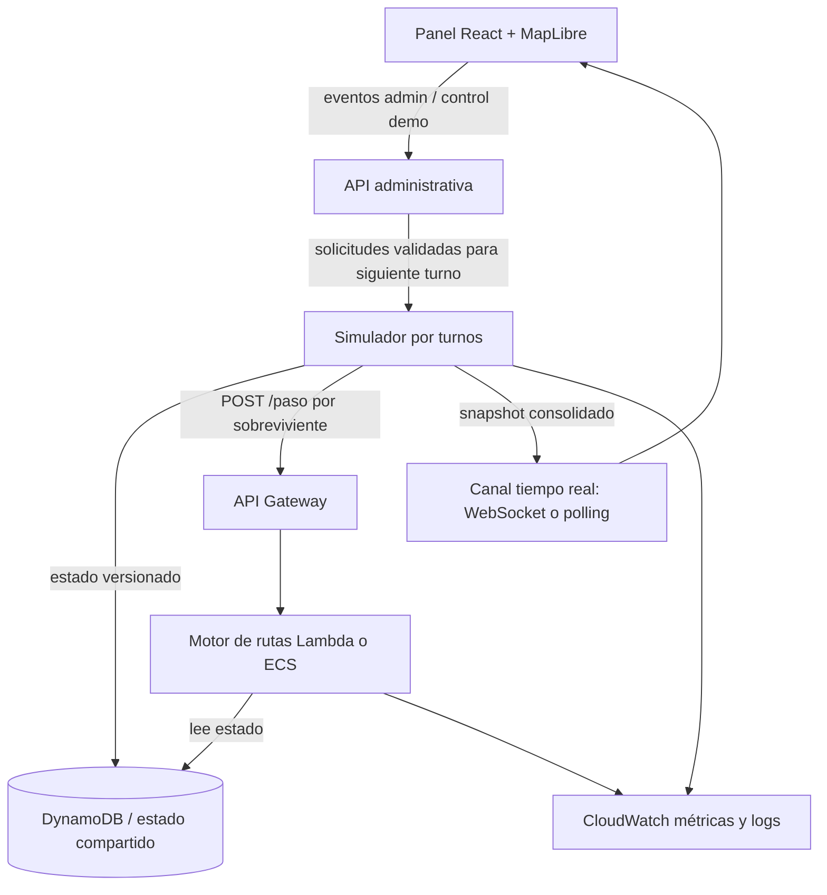

# SpookyThon 2026 — Track A: Escape de Manta Zombie

> Plan de implementación, criterios de aceptación y prompts para Kiro/Codex. Versión 1.0 — 26 de octubre de 2026.

## Ajustes al repositorio real (prevalecen sobre el resto del plan)

> Acordado el 26 de octubre de 2026 al contrastar este plan con el repositorio y `AGENTS.md`. Si algo de este documento contradice esta tabla, **gana la tabla**. Los agentes (Kiro/Codex/Claude) deben leerla antes que cualquier prompt.

| # | El plan dice | Se hace | Por qué |
|---|---|---|---|
| A1 | React + Vite; `apps/web`, `services/simulator`, `services/router`, `packages/shared`, `assets/map`, `scripts/` | Se mantiene la estructura actual: `frontend/` (Next.js, export estático), `backend/` (Lambda Hono), `shared/`, `tools/osm/`, `tools/simulador/`, `infra/` (`AGENTS.md` §3) | Ya está cableada en Terraform y en el deploy; reestructurar cuesta horas y no suma puntos |
| A2 | Modelo en inglés: `Node`, `Edge`, `Shelter`, `Survivor`, `Zombie`, `distanceM`, `roadType` | Modelo en español de `AGENTS.md` §4.1: `Nodo`, `Calle`, `Refugio`, `distancia_m`, `tipo`; identificadores `N-0000`, `S-0000`, `C-0000` | El contrato oficial está en español (`sobrevivienteId`, `siguienteNodo`) y `shared/index.ts` ya lo usa |
| A3 | Peso de arista `distanceM / speedMps` | Costo base `1 turno + ε × tiempo(distancia_m, tipo)` (`AGENTS.md` §4.4) | Si un sobreviviente avanza una arista por turno (Q2), la eficiencia se mide en turnos; optimizar en tiempo elige rutas con más saltos |
| A4 | `GET /survivors/:id/route` | `GET /api/sobrevivientes/:id/ruta`, calculada a pedido con la misma función de `shared/` que usa `/paso`. `/paso` **no** escribe rutas en DynamoDB y `/estado` no incluye rutas | Escribir la ruta en cada `/paso` serían 200 escrituras por turno en el camino crítico de la latencia |
| A5 | API administrativa web (`/admin/simulations`, `/admin/events`) | P0: el simulador se controla por CLI (ronda, semilla, eventos programados). La API admin con autenticación propia es P1 y solo si sobra tiempo el martes | Evita sumar una superficie de seguridad nueva antes de cerrar P0 |
| A6 | `Edge.geometry` | `Calle.geometria: [lng, lat][]` exportada por OSMnx, solo para dibujar | Las calles se ven reales en el mapa; el motor sigue usando `desde`/`hasta` |
| A7 | Simulador "en un componente persistente o coordinador único" | El simulador es una **Lambda que juega una ronda completa** en una invocación (5 min de ronda, límite de Lambda 15 min): loop de turnos de 2 s, escribe cada turno en DynamoDB y llama a `/paso` por sobreviviente. Mismo código que `tools/simulador/`, que también corre en local para desarrollo. **Modo evaluación:** `aws lambda invoke` con ronda y semilla. **Modo demo:** EventBridge Scheduler arranca una ronda periódica para que la URL pública nunca muestre un mapa congelado | El reto exige "todo desplegado en AWS" y una URL pública que funcione hasta el pitch; un simulador en una laptop deja el mapa congelado cuando nadie lo corre. Una sola invocación por ronda es el coordinador único; el motor lee el estado por `FuenteMundo` (`AGENTS.md` T0.6) por si la organización corre su propio simulador (Q3) |
| A9 | Solo se dibuja la ruta del sobreviviente seleccionado | Siempre hay una ruta planificada visible: al cargar, el mapa **auto-selecciona** un sobreviviente activo (y pasa a otro si llega o lo muerden) y muestra su ruta completa. Además, el snapshot incluye el `siguienteNodo` de cada sobreviviente y el mapa dibuja una flecha corta por sobreviviente hacia su próximo nodo | El reto exige que el mapa en vivo muestre la "ruta planificada"; si el jurado no toca nada, igual la ve, sin dibujar 200 rutas completas |
| A8 | Rutas de archivos en los prompts (`docs/PLAN_IMPLEMENTACION.md`, PDF) | Este archivo vive en `docs/PLAN_IMPLEMENTACION.md`; el enunciado oficial textual está en `AGENTS.md` §0 | Los prompts lo referencian por esa ruta |

El cambio de Leaflet a MapLibre de la sección 9 **ya está aplicado** en `AGENTS.md` §§2, 3, 6 y 9.

## 0. Objetivo y alcance

Construir una **plataforma de simulación y monitoreo de evacuación en tiempo real** desplegada en AWS. El simulador mueve zombies y administra el estado del mundo; por cada sobreviviente y turno consulta `POST /paso`, y el motor devuelve un siguiente nodo válido hacia un refugio. El dashboard permite observar el estado general y explorar individuos sin saturar el mapa.

**No construir cuentas, perfiles, login de sobrevivientes ni perfiles de conductores.** Los sobrevivientes y zombies son entidades simuladas. La `x-api-key` del contrato protege el endpoint; no equivale a un sistema de usuarios. La flota de rescate es nivel Pro, no un requisito base.

### Fuente de verdad y prioridades

- **Obligatorio (P0):** mapa de Manta como grafo (~300 intersecciones, calles con distancia/tipo/velocidad, cuatro refugios), turnos de 2 segundos (zombies primero, sobrevivientes después), reglas de cuatro tipos de zombies, mordidas por compartir nodo o cruzarse en sentidos opuestos, eventos que bloquean aristas, simulador con `GET /estado` o WebSocket, `POST /paso` por sobreviviente y turno, respuesta <500 ms, API key, rutas válidas, algoritmo de rutas, mapa en vivo, AWS, presupuesto, pruebas y entregables.
- **Producto recomendado (P1):** mapa general con capas, panel estadístico, listado de zombies clicable, inspección individual de sobrevivientes, gestión controlada de eventos, indicadores de recálculo, telemetría y pruebas reproducibles.
- **Extras (P2):** predicción de corredores, capacidad de refugios, cinco camionetas de rescate (hasta cuatro personas y doble velocidad), efectos visuales avanzados. No bloquear P0 por P2.

> Las reglas y porcentajes de evaluación proceden del PDF del reto. Las vistas, endpoints administrativos y detalles de arquitectura son propuestas del equipo, no exigencias textuales del organizador.

## 1. Comportamiento de la simulación

1. Se carga un grafo versionado de Manta, cuatro refugios y una semilla aleatoria para reproducibilidad.
2. Se configura una ronda: R1 = 20 sobrevivientes y caminantes; R2 = 80, caminantes/corredores/hordas y colapso de un puente; R3 = 200, todos los tipos (incluidos dormidos) y dos calles bloqueadas en vivo.
3. Cada 2 segundos, el simulador avanza un turno: actualiza zombies según reglas, activa eventos programados, publica un estado consistente, solicita `POST /paso` para cada sobreviviente activo, valida las respuestas, aplica movimientos y resuelve mordidas/refugios.
4. El motor calcula un siguiente nodo vecino por arista transitable, o el nodo actual; elige un refugio y reacciona a los cambios del mundo. La política ante riesgos debe estar documentada.
5. El frontend recibe un **snapshot consolidado** por turno; no necesita recibir 200 rutas completas. Dibuja la ruta completa del sobreviviente seleccionado (con auto-selección al cargar) y una flecha al próximo nodo de cada sobreviviente (ajuste A9).

### Reglas de zombies

- **Caminante:** una calle cada dos turnos, dirección aleatoria.
- **Corredor:** dos calles por turno; persigue si un sobreviviente está a tres nodos o menos.
- **Horda:** casi inmóvil; bloquea su nodo **y todos sus vecinos**.
- **Dormido:** invisible hasta que un sobreviviente está a dos nodos o menos; despierta como caminante.
- **Mordida:** compartir nodo al final de turno o cruzarse por una misma calle en direcciones opuestas. Implementar pruebas explícitas para ambos casos.

### Estado y consistencia

Usar un identificador de simulación, `roundId`, `turn`, `graphVersion` y `snapshotVersion`. Mantener el estado autoritativo del simulador en un componente persistente o coordinador único; **nunca asumir memoria compartida entre instancias Lambda**. Guardar snapshots/estado accesibles por el motor en DynamoDB (o alternativa razonada) y distinguir escritura de simulación de lectura del dashboard. Para la prueba de carga, evitar 200 lecturas pesadas del mismo snapshot: estudiar cache versionada y carga del grafo estático al iniciar procesos, midiendo consistencia y latencia.

## 2. Arquitectura propuesta

> ⚠️ **Superado en parte:** el stack es Next.js en `frontend/` (A1), el simulador corre como Lambda (A7) y no hay API administrativa en P0 (A5). Ver la tabla de ajustes y `AGENTS.md` §1–§2.



**Stack recomendado:** React + TypeScript + Vite; `maplibre-gl` + `react-map-gl/maplibre`; estilo CARTO Dark Matter con atribución correcta; GeoJSON para puntos, calles, zonas y ruta individual; backend Node.js/TypeScript o Python (elegir uno según experiencia); API Gateway + Lambda como primera opción para `POST /paso`, con evaluación de cold starts y p95; DynamoDB para estado compartido; S3 + CloudFront o Amplify para hosting; CloudWatch; Terraform si el equipo ya domina lo suficiente para no comprometer la entrega. No introducir servicios solo por apariencia de complejidad.

**Advertencia:** `react-map-gl` usa integración específica de MapLibre y las versiones de sus paquetes deben ser compatibles. Verificar la licencia/uso del estilo CARTO, el origen de tiles y la atribución. MapLibre puede utilizar estilos compatibles de Amazon Location, pero el cambio puede requerir autenticación, configuración y revisión de compatibilidad: no prometer que siempre es solo cambiar una URL.

## 3. Modelo de datos mínimo

> ⚠️ **Superado:** el modelo vigente está en español en `AGENTS.md` §4 (A2): `Nodo`, `Calle`, `Refugio`, `Zombie`, `Sobreviviente`, `EstadoTurno`. Los nombres en inglés de abajo son solo referencia histórica.

```text
Node { id, lat, lng }
Edge { id, from, to, distanceM, roadType, speedMps, geometry, blocked }
Shelter { id, nodeId, name, capacity? }
Survivor { id, nodeId, status: ACTIVE|SAFE|BITTEN, targetShelterId?, lastMove? }
Zombie { id, type: WALKER|RUNNER|HORDE|SLEEPER, nodeId, active, lastMove? }
CityEvent { id, type, edgeIds, scheduledTurn?, appliedTurn?, status }
WorldSnapshot { simulationId, roundId, turn, graphVersion, survivors, zombies, blockedEdgeIds, events, shelters, metrics }
```

El mapa original conserva todas las calles; los bloqueos son un overlay de aristas inválidas. Para zonas, transformar el área de riesgo en un conjunto explícito de nodos/aristas afectados; la visualización y el algoritmo deben consumir la **misma versión**. La horda bloquea nodo y vecinos incluso si el círculo visual es aproximado.

## 4. Contratos API

### Contrato obligatorio del reto

```http
POST /paso
x-api-key: <API_KEY>
Content-Type: application/json

{"sobrevivienteId":"S-0089","nodoActual":"N-0117","turno":142}
```

```json
{"siguienteNodo":"N-0118"}
```

**Reglas:** responder en <500 ms; nodo vecino mediante arista no bloqueada o nodo actual. Si respuesta tarda o es inválida, el simulador aplica quedarse quieto. No añadir campos obligatorios a este contrato. Validar `x-api-key`, sin escribir secretos en código o logs.

### Interfaces internas propuestas (no exigidas)

> ⚠️ **Superado:** los endpoints vigentes son los de `AGENTS.md` §5 (`/api/estado`, `/api/sobrevivientes/:id/ruta`). Los de `/admin/*` son P1 (A5) y no se construyen en P0.

- `GET /estado`: snapshot por turno para simulador/dashboard, o WebSocket equivalente.
- `GET /survivors/:id/route`: ruta planificada solo para el sobreviviente seleccionado, indicando turno/versión; puede resolverse localmente si existe información suficiente.
- `POST /admin/simulations`: crea simulación con ronda/semilla.
- `POST /admin/simulations/:id/start|pause|reset`: controles de demostración.
- `POST /admin/events`: programa un bloqueo para un turno futuro; no muta arbitrariamente el turno ya publicado.
- `GET /metrics`: resumen de supervivencia, latencia p50/p95, errores y turnos.

Separar API administrativa del endpoint público del reto. Si se exponen controles administrativos en Internet, protegerlos con autenticación/autorización adecuadas; una API key compartida para `/paso` no debe otorgar permisos administrativos. Para el MVP, también es válido restringir esos controles al entorno de demo.

## 5. Diseño de interfaz y rendimiento

### Vista general — monitoreo

- **Mapa MapLibre GL:** capas GeoJSON de calles, calles bloqueadas, zombies, sobrevivientes, refugios y zonas de peligro. Evitar un componente React DOM por cada entidad; usar fuentes/capas GPU.
- **No dibujar 200 rutas completas simultáneas.** Vista general: posiciones, flecha al próximo nodo de cada sobreviviente y la ruta completa del seleccionado (auto-selección al cargar, ajuste A9); usar selección/hover para inspección. Si hay densidad visual, agrupar marcadores o variar zoom.
- **Panel fijo:** ronda, turno, sobrevivientes activos, a salvo, mordidos, p95 de `/paso`, indicador `● EN VIVO` basado en edad real del último snapshot, no decorativo.
- **Leyenda persistente:** tipos de zombie, sobrevivientes, refugios, bloqueos y zonas.
- **Eventos recientes:** turno, tipo, aristas afectadas, impacto sobre rutas; destacar tramo bloqueado en rojo y explicar el recálculo.

### Vista de inspección individual

- Al **hover** sobre sobreviviente: resaltar ruta y refugio si los datos están disponibles; en dispositivos táctiles usar clic. Para no sobrecargar consultas, preferir ruta bajo demanda al seleccionar, y hover con debounce/caché.
- Al **clic**: fijar selección, `flyTo` a su posición, mostrar ID, estado, nodo, refugio objetivo, longitud estimada, última decisión y cambios de ruta.
- Si cambia la ruta, mostrar un **flash breve** en la línea seleccionada y registrar `ROUTE_RECALCULATED`. El flash no debe ocultar la ruta ni depender de que el usuario lo vea.

### Listado de zombies

- Tabla/panel filtrable por ID, tipo, estado y nodo, con coordenadas lat/lng.
- Clic en coordenadas: `map.flyTo({center:[lng,lat], zoom:...})`, resaltar zombie y abrir popup de información.
- Refrescar registros con cada snapshot; mantener selección por ID aunque cambie de nodo. Para dormidos, respetar la regla de invisibilidad: no revelar en vista pública antes de despertar; permitir vista de depuración **claramente diferenciada** si se usa durante pruebas.

### Gestión de rondas y eventos

- Elegir R1/R2/R3 y semilla antes de iniciar; mostrar composición de entidades y reglas.
- Administrar zombies y sobrevivientes por ronda desde el **simulador**, no desde perfiles de usuarios.
- Para el modo demo, seleccionar una calle válida, programar `ROAD_BLOCKED` o `BRIDGE_COLLAPSED`, mostrar confirmación y aplicar en el siguiente turno. No permitir bloquear coordenadas arbitrarias que no correspondan a aristas.
- Separar **modo evaluación reproducible** (reglas/escenarios preestablecidos) de **modo demo interactiva** (eventos activados manualmente), para no contaminar los resultados oficiales.

### Animación e implementación de capas

- Actualizar fuentes GeoJSON por snapshot; usar `setData` o actualización equivalente en las fuentes MapLibre. Usar expresiones de estilo para colores por tipo/estado sin iterar sobre marcadores DOM.
- Interpolar visualmente entre posiciones del turno `t` y `t+1` durante 2 segundos, solo cuando exista una trayectoria válida; no interpolar sobre un bloqueo ni inferir rutas inexistentes.
- **La simulación y las mordidas usan estados discretos, nunca posiciones interpoladas.** Si una entidad atraviesa dos aristas en un turno, representar sus segmentos de forma coherente.
- Medir FPS, tamaño de snapshot, memoria, tiempo de actualización de fuente y latencia p95. Preferir una animación simple y correcta antes que efectos costosos.

## 6. Algoritmo de rutas

1. Construir lista de adyacencia con costo base `1 turno + ε × tiempo(distancia_m, tipo)` (ajuste A3; no usar solo `distancia_m / velocidad`).
2. Implementar Dijkstra como baseline verificable; A* opcional con heurística admisible basada en distancia geográfica y velocidad máxima.
3. Excluir aristas bloqueadas y nodos peligrosos (horda y vecinos); considerar zombies visibles y posibles colisiones por cruce.
4. Elegir refugio alcanzable de menor costo estimado; si ninguno es alcanzable, devolver nodo actual y registrar motivo.
5. Recalcular cuando cambian bloqueos/amenazas/posición; optimizar solo después de medir. No conservar rutas obsoletas entre turnos.
6. Probar respuesta válida y rápida para 20, 80 y 200 sobrevivientes; medir p50/p95/p99 y errores. Objetivos de puntuación: p95 <=150 ms (máximo en latencia), <=300 ms (intermedio), <=500 ms (mínimo puntuable); la obligación por solicitud es <500 ms.

## 7. Plan de ejecución y reparto (3 integrantes)

**Fecha límite oficial:** miércoles 28 de octubre de 2026 a las 10:00, hora de Ecuador. Demo presencial: viernes 30 de octubre, pitch de 5 minutos y 3 minutos de preguntas. Priorizar entrega verificable antes de efectos visuales.

| Fase | Responsable principal | Resultado | Prioridad |
|---|---|---|---|
| 0. Contratos, repositorio y mapa | Todos (integración: persona A) | Grafo Manta, 4 refugios, API y datos compartidos | P0 |
| 1. Simulador | Persona A | Turnos, zombies, eventos, mordidas, rondas reproducibles | P0 |
| 2. Motor `/paso` | Persona B | Rutas válidas, seguridad y tests de latencia | P0 |
| 3. Dashboard | Persona C | MapLibre, capas, métricas, selección individual | P0/P1 |
| 4. Integración AWS | A + B, apoyo C | API, estado compartido, hosting, CloudWatch, Budget | P0 |
| 5. Pruebas y entrega | Todos | R1/R2/R3, README, arquitectura, costos, pitch | P0 |

**26 oct:** congelar alcance, contratos y mapa; construir simulador mínimo, motor mínimo y mapa funcional en paralelo. **27 oct:** integrar, ejecutar rondas completas, corregir colisiones/latencia, desplegar AWS, documentar costos y presupuesto; cerrar P0. **28 oct antes de las 10:00:** validar URL, API, repositorio y entrega. Reservar margen real para errores de despliegue. No esperar al último minuto.

## 8. Prompts secuenciales para Kiro/Codex

> Regla de uso: dar **un prompt a la vez**. Exigir explicación de decisiones, cambios pequeños, pruebas y revisión del diff. No aceptar código que no puedan explicar. Cada agente debe leer este plan, el PDF y `AGENTS.md` antes de modificar archivos.

### Prompt 0 — Auditoría y planificación del repositorio

```text
Actúa como arquitecto y mentor técnico. Lee docs/PLAN_IMPLEMENTACION.md, AGENTS.md y la estructura actual del repositorio. No escribas código todavía. Identifica el stack existente, archivos relevantes, decisiones pendientes, dependencias, riesgos para la entrega y un plan de commits pequeños. Distingue P0 del reto y P1/P2 del producto. Señala contradicciones, especialmente Leaflet vs MapLibre. Haz máximo 5 preguntas bloqueantes y propone defaults para el resto. No inventes archivos ni ejecuciones.
```

### Prompt 1 — Grafo real de Manta y contratos

```text
Implementa de forma incremental el módulo de grafo de Manta con ~300 intersecciones que cubran los barrios de inicio de los sobrevivientes (Tarqui, Los Esteros, Barbasquillo y Jocay), marcando a qué barrio pertenece cada nodo de inicio, aristas con distancia_m, tipo y velocidad, geometrías para GeoJSON y 4 refugios. Usa una fuente reproducible de OpenStreetMap, documenta método/licencia y verifica conectividad. Define contratos y tipos compartidos en español según AGENTS.md §4.1 (Nodo, Calle con geometria, Refugio, Zombie, EstadoTurno, Evento; ajustes A2 y A6). Incluye validadores, fixture pequeño para tests y pruebas de nodos vecinos, aristas bloqueadas y geometrías. Antes de codificar explica modelo, supuestos y tradeoffs; después muestra tests y cambios realizados.
```

### Prompt 2 — Simulador autoritativo

```text
Construye el simulador determinista con semilla, reloj discreto de 2 segundos, R1=20, R2=80, R3=200 sobrevivientes repartidos en Tarqui, Los Esteros, Barbasquillo y Jocay, cuatro tipos de zombies, eventos de bloqueo y resolución de mordidas (mismo nodo y cruce en direcciones opuestas). El simulador mueve zombies primero, consulta POST /paso por sobreviviente y valida la respuesta antes de aplicar movimientos. Implementa GET /estado o mecanismo equivalente, incluyendo el siguienteNodo de cada sobreviviente (ajuste A9). Empaquétalo también como Lambda que juega una ronda completa por invocación (ajuste A7) y documenta cómo invocarla en modo evaluación y cómo la programa EventBridge Scheduler en modo demo. No uses el frontend como fuente de verdad. Agrega pruebas por regla y logs por turno. Explica cómo reproducir una ronda y cómo evitar condiciones de carrera.
```

### Prompt 3 — Motor de rutas y contrato estricto

```text
Implementa POST /paso con exactamente el cuerpo {sobrevivienteId,nodoActual,turno} y respuesta {siguienteNodo}; valida x-api-key y responde en menos de 500 ms. Usa Dijkstra o A* con costo base 1 turno + ε × tiempo(distancia_m, tipo) (ajuste A3), no solo distancia/velocidad; evita aristas bloqueadas, zombies visibles, bloqueo de nodo+vecinos por hordas y calles por las que un zombie puede venir de frente en el próximo turno (mordida por cruce, AGENTS.md §4.4); con presupuesto interno de 300 ms, si el cálculo no termina responde un paso seguro de respaldo, nunca un error (AGENTS.md §4.3); elige refugio alcanzable. Devuelve nodo actual si no hay movimiento válido. Usa estado compartido versionado leído a través de FuenteMundo; no dependas de memoria global de Lambda; /paso no escribe rutas en DynamoDB (ajuste A4). Escribe tests de validez, replanificación, bloqueo y casos sin ruta. Mide p50/p95/p99 con concurrencia 20/80/200. Explica cada optimización antes de aplicarla.
```

### Prompt 4 — Mapa MapLibre y vista general

```text
Implementa dashboard en frontend/ (Next.js con export estático, ajuste A1) + TypeScript con maplibre-gl y react-map-gl/maplibre, estilo CARTO Dark Matter y atribución visible. Usa capas/fuentes GeoJSON separadas para calles, bloqueos, zombies, sobrevivientes, refugios y zonas de horda. Cada snapshot actualiza datos sin recrear el mapa. No renderices todas las rutas completas: muestra marcadores, una flecha al próximo nodo de cada sobreviviente, la ruta completa del sobreviviente auto-seleccionado (ajuste A9) y leyenda fija. Panel con ronda, turno, activos, a salvo, mordidos, p95 real y LIVE condicionado al último snapshot. Incluye estados de carga, error y desconexión. Mide FPS y rendimiento con 200 sobrevivientes. No añadas deck.gl.
```

### Prompt 5 — Inspección individual y zombies clicables

```text
Agrega panel de sobrevivientes con búsqueda por ID y selección persistente; al seleccionar, usa flyTo y muestra exclusivamente su ruta y refugio (GET /api/sobrevivientes/:id/ruta, ajuste A4), con información de turno/versión. En hover, resalta de forma ligera con debounce sin hacer cientos de solicitudes. Agrega listado filtrable de zombies con ID, tipo, estado, nodo y coordenadas; clic en coordenadas centra y destaca el zombie. Respeta invisibilidad de zombies dormidos en vista normal. Incluye flash de recálculo de la ruta seleccionada y pruebas de interacción. Explica cómo evitar renderizados innecesarios.
```

### Prompt 6 — Panel de eventos y rondas

```text
(P1: en P0 estos controles son CLI del simulador, ajuste A5.) Construye panel de control para iniciar/pausar/reiniciar simulaciones y elegir R1/R2/R3 con semilla. En modo demo permite seleccionar una arista válida y programar bloqueo/colapso para el siguiente turno. Al aplicarse, pinta el tramo rojo, actualiza estado versionado, registra evento y muestra rutas recalculadas; no modifiques arbitrariamente el estado a mitad del turno. Separa modo demo de modo evaluación reproducible. Agrega pruebas de consistencia mapa-motor y manejo de permisos administrativos.
```

### Prompt 7 — AWS, seguridad, presupuesto y observabilidad

```text
Despliega el mínimo funcional en AWS con arquitectura justificada: API Gateway + Lambda o ECS para /paso, estado compartido (p.ej. DynamoDB), frontend en S3+CloudFront o Amplify y CloudWatch. Configura x-api-key sin secretos en repositorio, IAM mínimo privilegio, CORS controlado y protección de endpoints admin. Crea AWS Budget con alerta y guarda captura para docs/budget.png. Define infraestructura reproducible con Terraform solo si no retrasa P0. Verifica cold starts, p95, errores y costos. Documenta comandos exactos de despliegue y rollback.
```

### Prompt 8 — Prueba de fuego y entrega

```text
Ejecuta tres rondas consecutivas de cinco minutos con reglas oficiales: R1 20 sobrevivientes y caminantes; R2 80 con corredores/hordas y puente colapsado; R3 200 con dormidos y dos calles bloqueadas. Registra supervivencia, eficiencia, p95 de POST /paso, disponibilidad, fallos y evidencia de replanificación. No alteres las reglas para mejorar el puntaje. Genera README con uso/despliegue/pruebas/decisiones/limitaciones, docs/arquitectura.png, docs/costos.md, captura Budget, URL pública, URL /paso y explicación de medición. Prepara pitch de 5 minutos (PDF, PPT o PPTX de 20 MB como máximo) y preguntas técnicas. Señala cualquier criterio P0 no cumplido.
```

### Prompt 9 — Revisión final de calidad (solo si P0 está listo)

```text
Revisa la solución como jurado adversarial. Busca: rutas calculadas una sola vez, horda sin bloqueo de vecinos, estado guardado solo en memoria Lambda, p95 >500 ms, mapa congelado, visualización distinta del estado autoritativo, zombis dormidos revelados, secretos en repositorio, presupuestos ausentes, simulación no reproducible y README incompleto. Prioriza bugs de corrección y rendimiento sobre diseño. Propón fixes pequeños con pruebas; no introduzcas dependencias nuevas sin justificar.
```

## 9. Cambio requerido en AGENTS.md

No editar a ciegas: revisar el archivo real, especialmente §§2 y 6, y sustituir cualquier referencia normativa a **Leaflet** por:

```md
Frontend de mapas: MapLibre GL JS + react-map-gl (integración MapLibre),
con estilo CARTO Dark Matter y atribuciones obligatorias.
Representar entidades y calles mediante fuentes/capas GeoJSON;
actualizar por snapshot; mostrar siempre la ruta completa del sobreviviente seleccionado
(auto-selección al cargar) y una flecha al siguienteNodo de cada sobreviviente (ajuste A9).
Interpolar posiciones visualmente entre turnos sin alterar el estado autoritativo.
No incorporar deck.gl en P0. Documentar compatibilidad/credenciales
si se migra a estilos de Amazon Location Service.
```

Revisar también dependencias, arquitectura, comandos, pruebas y cualquier otra sección que siga mencionando Leaflet. Registrar el cambio en un commit específico.

## 10. Criterios de aceptación y checklist

### P0 — antes de entregar

- [ ] Grafo Manta reproducible con ~300 nodos, calles y 4 refugios.
- [ ] Turnos de 2 segundos, zombies primero, sobrevivientes después.
- [ ] Cuatro tipos de zombies con reglas verificadas.
- [ ] Mordidas por mismo nodo y cruce opuesto, probadas.
- [ ] Eventos de bloqueo de aristas reflejados en motor y mapa.
- [ ] `POST /paso` con API key, respuesta válida <500 ms.
- [ ] `GET /estado` o WebSocket con estado por turno.
- [ ] Dijkstra/A* con distancia y tipo de calle.
- [ ] Mapa vivo desplegado en AWS y sincronizado.
- [ ] R1, R2 y R3 de cinco minutos cada una probadas.
- [ ] Latencia p95 y errores medidos; cold starts revisados.
- [ ] AWS Budget con alerta y captura en README.
- [ ] Repo público, commits reales, README, arquitectura, costos, URL pública, endpoint y método de prueba.
- [ ] Pitch preparado y entregables enviados antes del plazo.

### P1 — experiencia de monitoreo

- [ ] Vista general sin todas las rutas dibujadas.
- [ ] Selección individual muestra ruta y refugio.
- [ ] Lista de zombies con coordenadas clicables y `flyTo`.
- [ ] Dashboard con vivos/seguros/mordidos, turno, ronda, p95 y LIVE real.
- [ ] Bloqueos y zonas de horda visibles con leyenda.
- [ ] Panel de eventos con historial y recálculo perceptible.
- [ ] Modo demo y modo evaluación separados.

### P2 — solo con margen

- [ ] Capacidad de refugios.
- [ ] Predicción de corredores.
- [ ] Camionetas de rescate.
- [ ] Animaciones avanzadas o deck.gl.

## 11. Riesgos que no deben ignorarse

- **Latencia:** 200 consultas cada 2 s son ~100 req/s de promedio, pero pueden llegar en ráfaga; medir la concurrencia real y p95.
- **Sincronización:** una vista bonita pero congelada es un fallo explícito que buscará el jurado; mostrar edad del snapshot y reconexión.
- **Seguridad:** distinguir API key del motor y controles administrativos; no publicar claves.
- **Datos:** validar conectividad del grafo y licencias/atribuciones de mapas; no asumir que todas las calles están conectadas.
- **Tiempo:** no construir autenticación de personas, Uber, chat, pagos ni geolocalización de usuarios reales.
- **Exactitud:** animaciones, zonas y colores deben derivarse del estado real, no de datos independientes de frontend.

## 12. Estructura sugerida

```text
README.md
AGENTS.md
apps/web/                 # React + MapLibre
services/simulator/       # estado y turnos
services/router/          # POST /paso
packages/shared/          # tipos y contratos
assets/map/               # grafo y GeoJSON de Manta
infra/                    # Terraform u otra IaC (si aplica)
docs/PLAN_IMPLEMENTACION.md
docs/arquitectura.png
docs/arquitectura.drawio
docs/costos.md
docs/budget.png
scripts/                  # carga, simulación, benchmarks
```

**Definición de terminado:** el equipo puede explicar y demostrar una ruta que se recalcula cuando un evento bloquea una arista, el simulador completa R1–R3 sin violar reglas y el sistema está disponible en AWS con evidencias de latencia, costos y seguridad.
